

  <!-- Profile Visitor Badges & Status -->
  

    
    
    
  

  <!-- Main Hero Banner -->
  

    <a href="https://merxodevsolutions.pro.bd">
      
    </a>
  

---

##  Executive Summary

I am a **Full-Stack Software Engineer** and the **Founder & Lead Developer** at **[MerxoDev Solutions](https://merxodevsolutions.pro.bd/)**. 

I specialize in engineering high-performance **Next.js** applications, multi-tenant **SaaS platforms**, enterprise **e-commerce architectures**, and complex **API & Payment Gateway integrations** (bKash, Nagad, Stripe, Wise). With a focus on sub-second load times, clean code craftsmanship, and modern UI/UX design systems, I help startups, businesses, and global clients turn ambitious ideas into scalable digital realities.

- **Founder & Lead Engineer** at [MerxoDev Solutions](https://merxodevsolutions.pro.bd/) (Custom Web & App Agency)
- **56+ Production Projects** successfully architected and delivered across Bangladesh, USA, UK, and worldwide
- **Core Focus:** Sub-second latency (0.7s avg), SEO-first SSR/SSG rendering, 60FPS fluid animations, and high-converting UX
- **Open Source Contributor:** Author of developer utilities including [`bangladesh-geojson`](https://merxodevsolutions.pro.bd/tools) for geo-spatial mapping
- **Full Source Code Ownership:** Zero vendor lock-in, pristine codebase, automated CI/CD pipelines, and enterprise-grade security

---

##  Connect & Collaborate

  
  
  
  
  
  

---

##  Technology Stack & Engineering Arsenal

### Core Languages & Frontend Frameworks

  

### Backend Architecture & APIs

  

### Databases, ORM & Cloud Storage

  

### Cloud, Deployment & DevOps

  

### Product Design & Prototyping

  

---

##  Featured Solutions & Core Services

<table>
  <!-- Set 1: Content -->
  <tr>
    <td width="33.33%" valign="top" align="center">
       
      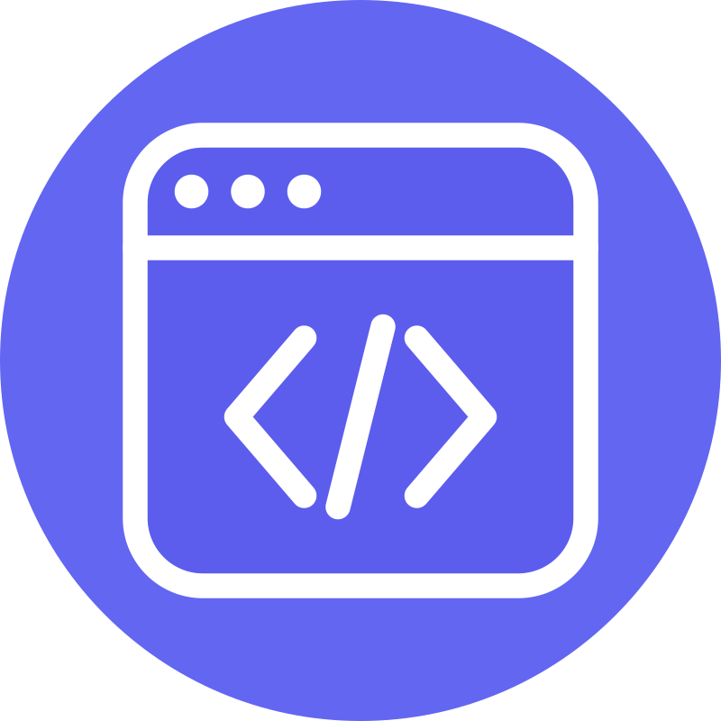
      <h3 align="center">Website Development</h3>
      
Fast, responsive, and SEO-ready websites built with Next.js and React.

    </td>
    <td width="33.33%" valign="top" align="center">
       
      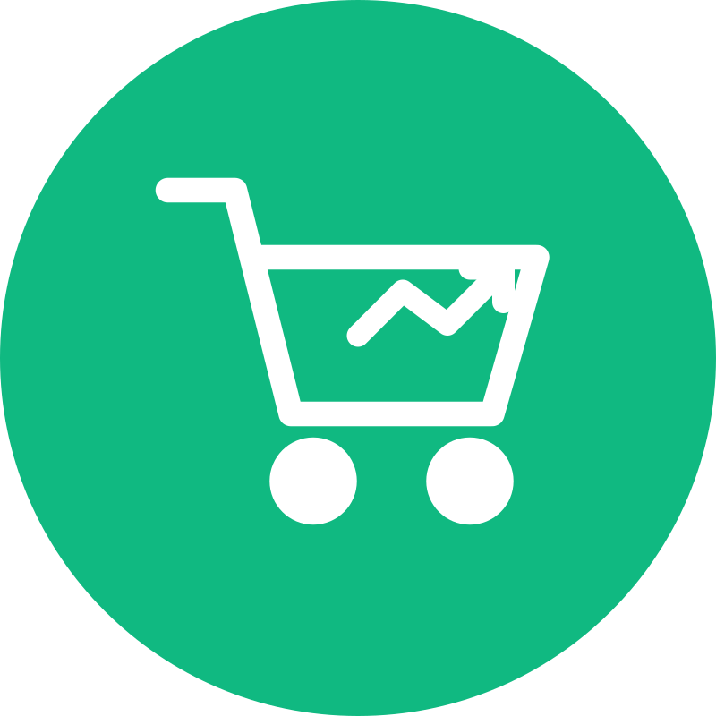
      <h3 align="center">E-commerce Development</h3>
      
High-converting online stores with instant cart synchronization and checkout.

    </td>
    <td width="33.33%" valign="top" align="center">
       
      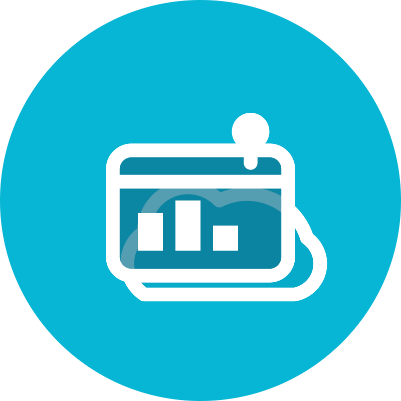
      <h3 align="center">Plugin Development</h3>
      
Custom WordPress plugins and extensions tailored to your business logic.

    </td>
  </tr>
  <!-- Set 1: Perfectly Aligned Buttons -->
  <tr>
    <td width="33.33%" valign="middle" align="center">
      
      &nbsp;
      
        
    </td>
    <td width="33.33%" valign="middle" align="center">
      
      &nbsp;
      
        
    </td>
    <td width="33.33%" valign="middle" align="center">
      
      &nbsp;
      
        
    </td>
  </tr>

  <!-- Set 2: Content -->
  <tr>
    <td width="33.33%" valign="top" align="center">
       
      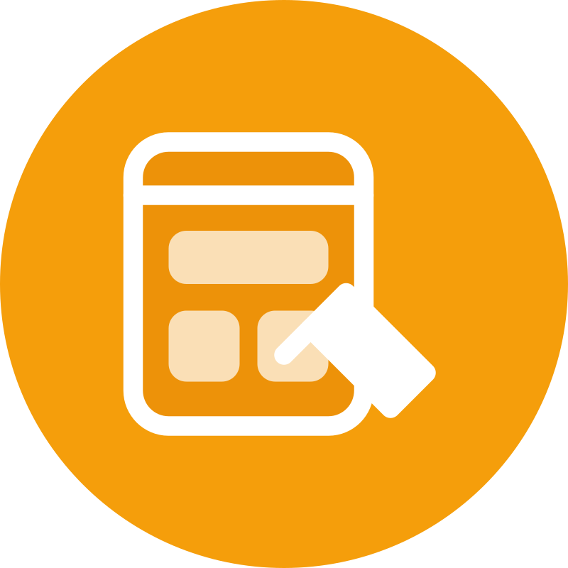
      <h3 align="center">UI/UX Design</h3>
      
Intuitive Figma design systems brought to life with 60FPS fluid motion.

    </td>
    <td width="33.33%" valign="top" align="center">
       
      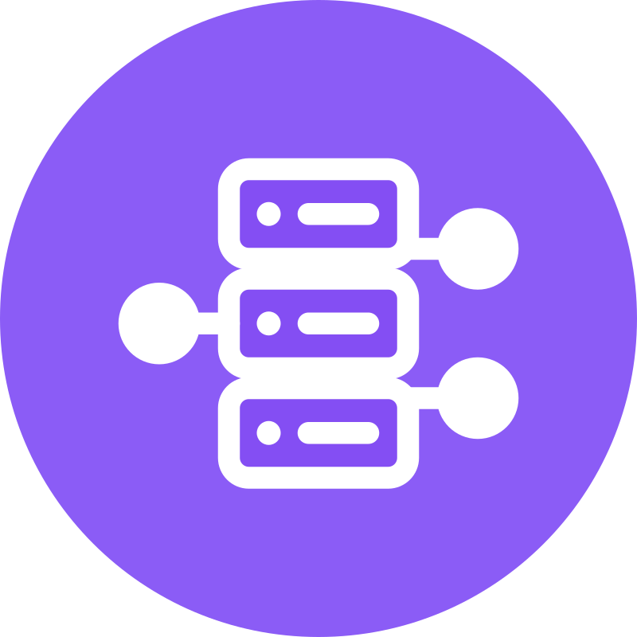
      <h3 align="center">API Development & Integration</h3>
      
RESTful/GraphQL APIs, webhooks, and third-party CRM/ERP sync.

    </td>
    <td width="33.33%" valign="top" align="center">
       
      
      <h3 align="center">Authentication & Security</h3>
      
Secure login, JWT, OAuth, 2FA, and role-based permissions (RBAC).

    </td>
  </tr>
  <!-- Set 2: Perfectly Aligned Buttons -->
  <tr>
    <td width="33.33%" valign="middle" align="center">
      
      &nbsp;
      
        
    </td>
    <td width="33.33%" valign="middle" align="center">
      
      &nbsp;
      
        
    </td>
    <td width="33.33%" valign="middle" align="center">
      
      &nbsp;
      
        
    </td>
  </tr>

  <!-- Set 3: Content -->
  <tr>
    <td width="33.33%" valign="top" align="center">
       
      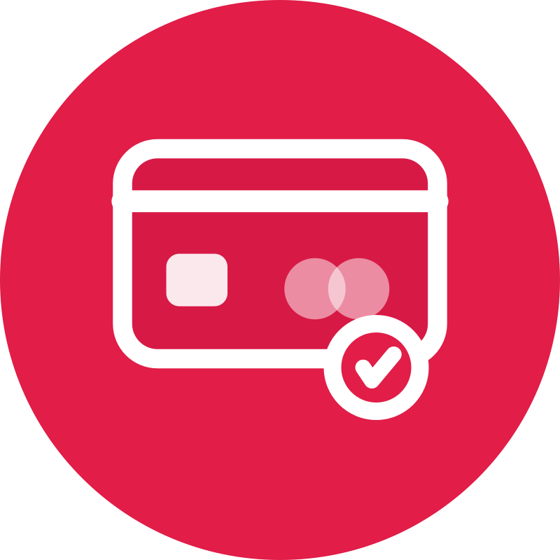
      <h3 align="center">Payment Gateway Integration</h3>
      
Custom bKash, Nagad, Stripe, and SSLCommerz checkout modules.

    </td>
    <td width="33.33%" valign="top" align="center">
       
      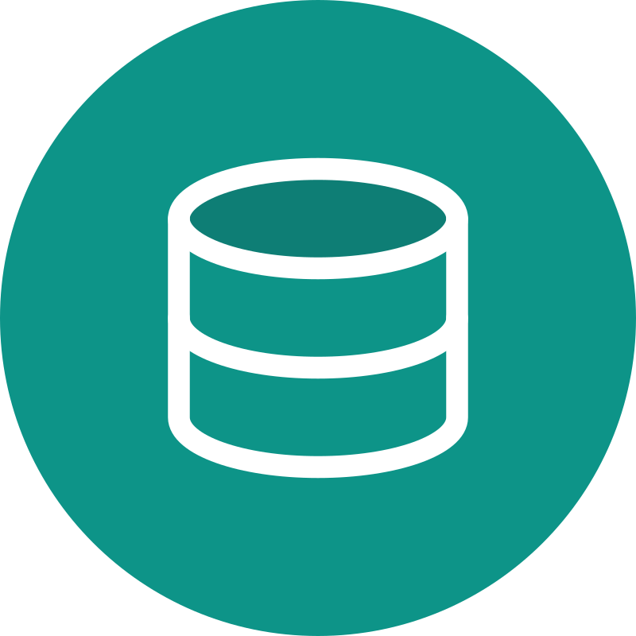
      <h3 align="center">Database Design & Management</h3>
      
Scalable PostgreSQL, MongoDB, and MySQL with query indexing and backups.

    </td>
    <td width="33.33%" valign="top" align="center">
       
      
      <h3 align="center">Website Maintenance & Support</h3>
      
Continuous monitoring, security patches, bug fixes, and 24/7 care.

    </td>
  </tr>
  <!-- Set 3: Perfectly Aligned Buttons -->
  <tr>
    <td width="33.33%" valign="middle" align="center">
      
      &nbsp;
      
        
    </td>
    <td width="33.33%" valign="middle" align="center">
      
      &nbsp;
      
        
    </td>
    <td width="33.33%" valign="middle" align="center">
      
      &nbsp;
      
        
    </td>
  </tr>

  <!-- Set 4: Content -->
  <tr>
    <td width="33.33%" valign="top" align="center">
       
      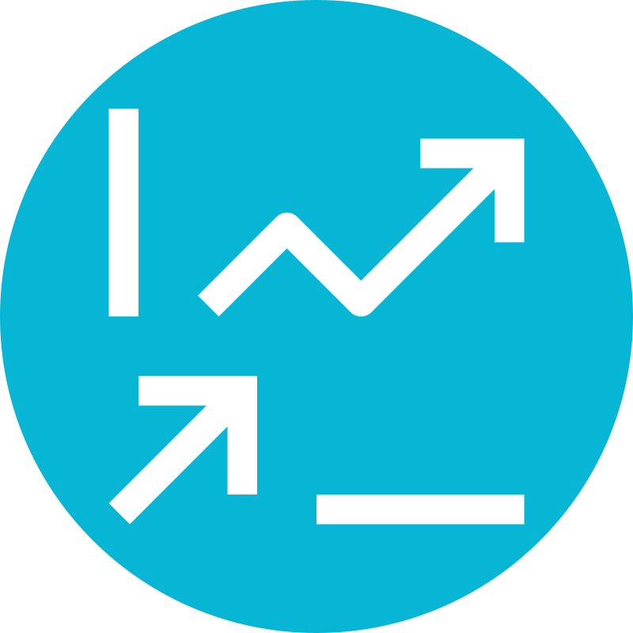
      <h3 align="center">SEO Optimization</h3>
      
Technical SEO audits, Core Web Vitals, and structured data rank growth.

    </td>
    <td width="33.33%" valign="top" align="center">
       
      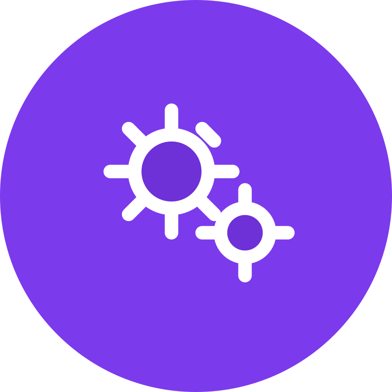
      <h3 align="center">Business Automation</h3>
      
Automate repetitive tasks, business workflows, and notification bots.

    </td>
    <td width="33.33%" valign="top" align="center">
       
      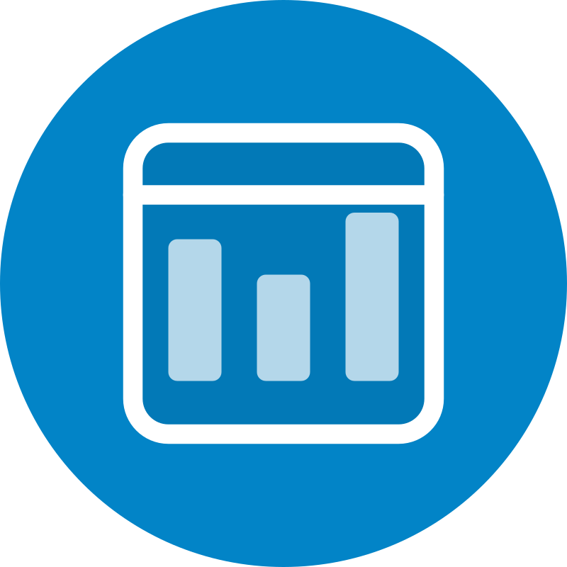
      <h3 align="center">Admin Dashboard Development</h3>
      
Real-time data visualization, charts, and granular role control panels.

    </td>
  </tr>
  <!-- Set 4: Perfectly Aligned Buttons -->
  <tr>
    <td width="33.33%" valign="middle" align="center">
      
      &nbsp;
      
        
    </td>
    <td width="33.33%" valign="middle" align="center">
      
      &nbsp;
      
        
    </td>
    <td width="33.33%" valign="middle" align="center">
      
      &nbsp;
      
        
    </td>
  </tr>
</table>

---

##  GitHub Analytics & Engineering Metrics

  
  

 

  

 

  

---

##  Let's Build Your Dream Project Together

Are you looking for a dedicated software engineering partner to build your next web application, SaaS product, or business platform? 

  
  
  

 

  

