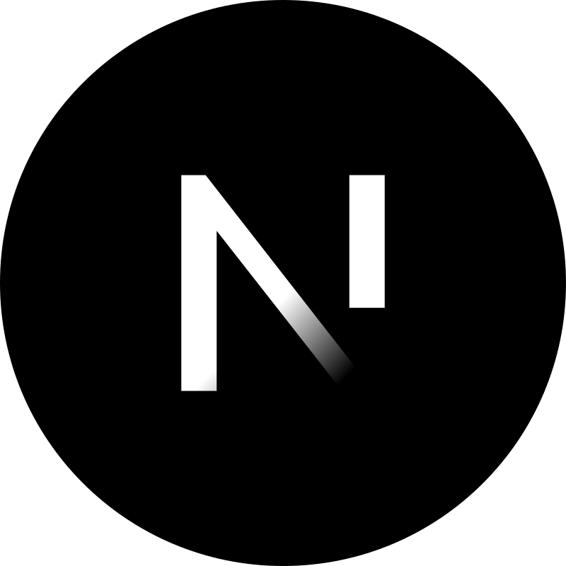
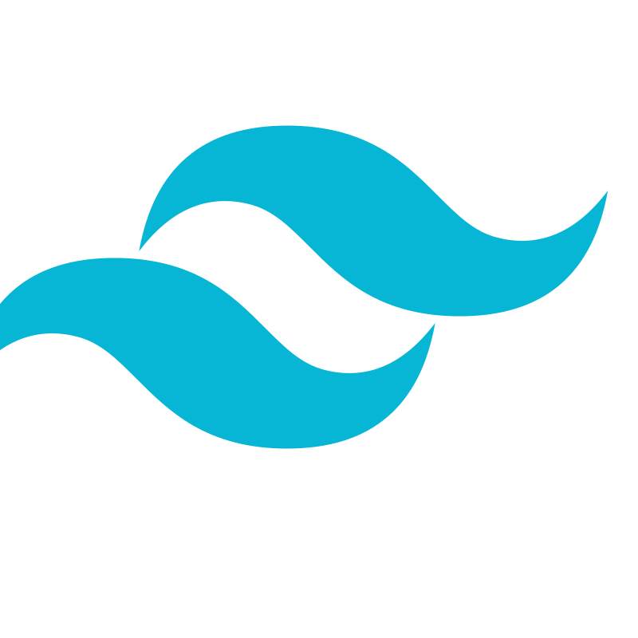
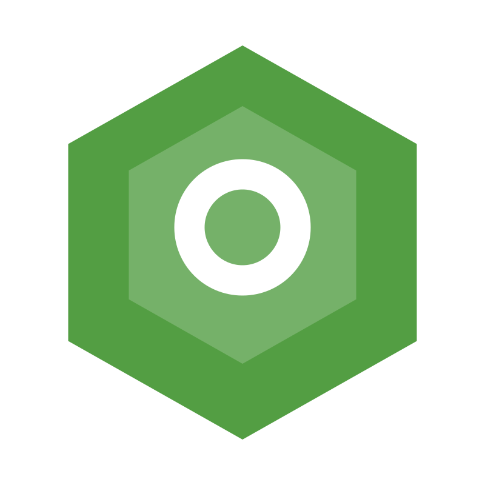
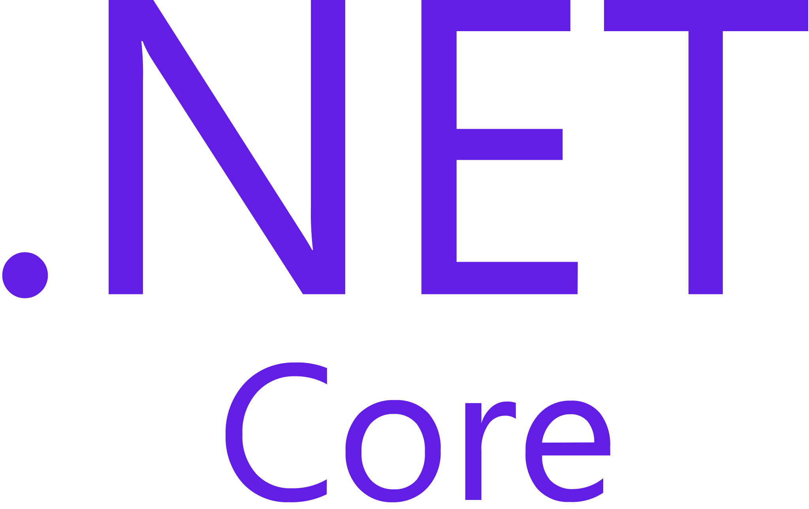
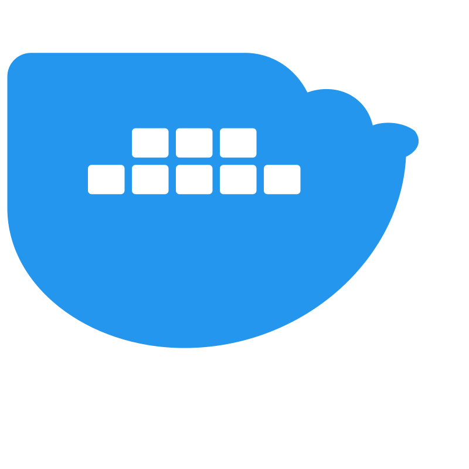
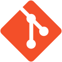
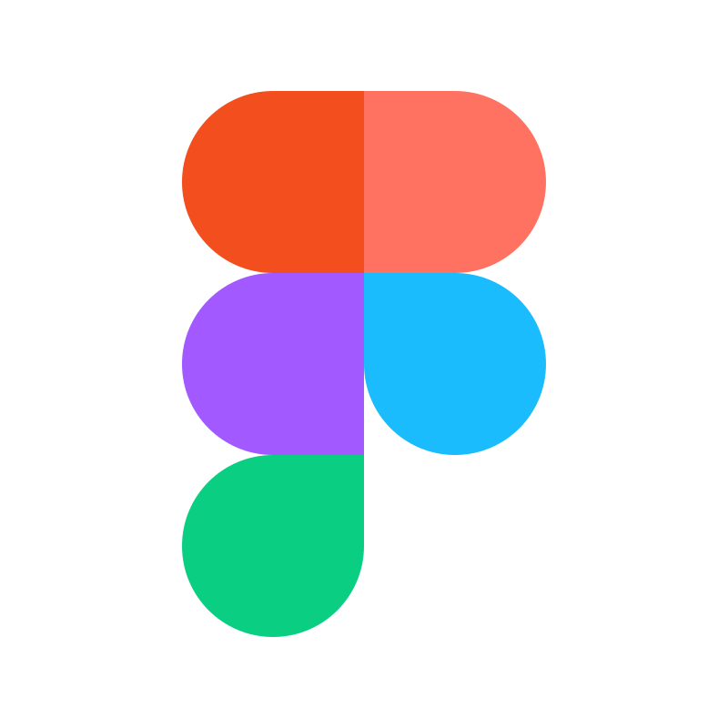
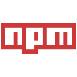
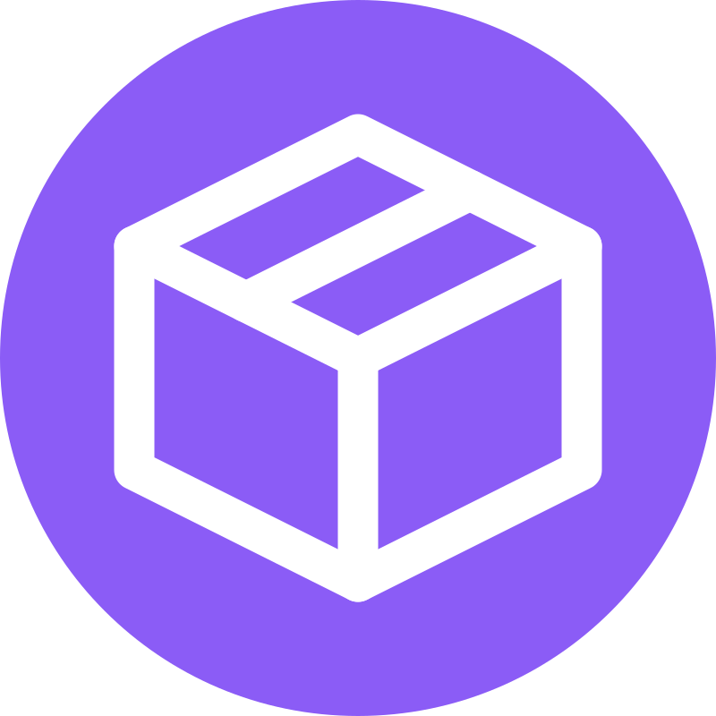

  <!-- Profile Visitor Badges & Status -->
  

    
    
    
  

  <!-- Main Hero Banner -->
  

    
  

---

##  Executive Summary

I am a **Full-Stack Software Engineer** and the **Founder & Lead Developer** at **[MerxoDev Solutions](https://merxodevsolutions.pro.bd/)**. 

I specialize in engineering high-performance **Next.js** applications, multi-tenant **SaaS platforms**, enterprise **e-commerce architectures**, and complex **API & Payment Gateway integrations** (bKash, Nagad, Stripe, Wise). With a focus on sub-second load times, clean code craftsmanship, and modern UI/UX design systems, I help startups, businesses, and global clients turn ambitious ideas into scalable digital realities.

- **Founder & Lead Engineer** at [MerxoDev Solutions](https://merxodevsolutions.pro.bd/) (Custom Web & App Agency)
- **56+ Production Projects** successfully architected and delivered across Bangladesh, USA, UK, and worldwide
- **Core Focus:** Sub-second latency (0.7s avg), SEO-first SSR/SSG rendering, 60FPS fluid animations, and high-converting UX
- **Open Source Contributor:** Author of developer utilities including [`bangladesh-geojson`](https://merxodevsolutions.pro.bd/tools) for geo-spatial mapping
- **Full Source Code Ownership:** Zero vendor lock-in, pristine codebase, automated CI/CD pipelines, and enterprise-grade security

---

##  Connect & Collaborate

  
  
  
  
  
  

---

##  Technology Stack & Engineering Arsenal

### Frontend & UI Engineering

   &nbsp;&nbsp;
   &nbsp;&nbsp;
   &nbsp;&nbsp;
   &nbsp;&nbsp;
   &nbsp;&nbsp;
   &nbsp;&nbsp;
   &nbsp;&nbsp;
   &nbsp;&nbsp;
  

 

### Backend Architecture & Programming Languages

   &nbsp;&nbsp;
   &nbsp;&nbsp;
   &nbsp;&nbsp;
   &nbsp;&nbsp;
   &nbsp;&nbsp;
   &nbsp;&nbsp;
   &nbsp;&nbsp;
   &nbsp;&nbsp;
  

 

### Databases, DevOps, Design & Tooling

   &nbsp;&nbsp;
   &nbsp;&nbsp;
   &nbsp;&nbsp;
   &nbsp;&nbsp;
   &nbsp;&nbsp;
   &nbsp;&nbsp;
   &nbsp;&nbsp;
   &nbsp;&nbsp;
   &nbsp;&nbsp;
  

---

##  Featured Flagship Projects & Solutions

<table>
  <tr>
    <td width="33.33%" valign="top" align="center">
       
      
      <h3 align="center">Full-Stack Web Development</h3>
      

        High-performance Next.js & React platforms with sub-second latency, SEO-first SSR/SSG rendering, and fluid responsive UX.
      

      

        <b>Core Tech:</b> Next.js, React, TypeScript, Tailwind
      

      

        
      

       
    </td>
    <td width="33.33%" valign="top" align="center">
       
      
      <h3 align="center">Custom SaaS Platforms</h3>
      

        Multi-tenant architectures, role-based authorization (RBAC), subscription billing, team management, and cloud workspaces.
      

      

        <b>Core Tech:</b> Next.js, PostgreSQL, Prisma, WebSockets
      

      

        
      

       
    </td>
    <td width="33.33%" valign="top" align="center">
       
      
      <h3 align="center">High-Converting E-Commerce</h3>
      

        Headless e-commerce stores with instant cart synchronization, dynamic inventory filtering, and high-conversion checkout funnels.
      

      

        <b>Core Tech:</b> Next.js, Node.js, MongoDB, Redux Toolkit
      

      

        
      

       
    </td>
  </tr>
  <tr>
    <td width="33.33%" valign="top" align="center">
       
      
      <h3 align="center">Fintech & Payment Gateways</h3>
      

        Tokenized payment modules for bKash, Nagad, Stripe, and SSLCommerz with recurring billing, webhooks, and fraud detection.
      

      

        <b>Core Tech:</b> Express, Webhooks, Cryptography, REST APIs
      

      

        
      

       
    </td>
    <td width="33.33%" valign="top" align="center">
       
      
      <h3 align="center">Custom APIs & Microservices</h3>
      

        High-throughput backend architectures, RESTful & GraphQL microservices, third-party ERP/CRM integrations, and real-time queues.
      

      

        <b>Core Tech:</b> Node.js, GraphQL, Redis, Docker, PostgreSQL
      

      

        
      

       
    </td>
    <td width="33.33%" valign="top" align="center">
       
      
      <h3 align="center">UI/UX & Frontend Systems</h3>
      

        Interactive design systems, 60FPS fluid animations, accessibility standards, and clean component architectures.
      

      

        <b>Core Tech:</b> Figma, Framer Motion, Tailwind, Turbopack
      

      

        
      

       
    </td>
  </tr>
</table>

---

##  Core Services We Deliver at MerxoDev

<table>
  <tr>
    <td width="50%" valign="top">
      <h4> Full-Stack Web Applications</h4>
      <ul>
        <li>Next.js 15 & React Platforms</li>
        <li>Sub-second performance (0.7s avg)</li>
        <li>Mobile-first responsive UX</li>
      </ul>
    </td>
    <td width="50%" valign="top">
      <h4> Custom SaaS Platform MVPs</h4>
      <ul>
        <li>Multi-tenant architecture</li>
        <li>Role-based auth & permissions</li>
        <li>Subscription billing (Stripe & bKash)</li>
      </ul>
    </td>
  </tr>
  <tr>
    <td width="50%" valign="top">
      <h4> High-Converting E-Commerce</h4>
      <ul>
        <li>Headless e-commerce stores</li>
        <li>Dynamic inventory & analytics</li>
        <li>Optimized checkout funnels</li>
      </ul>
    </td>
    <td width="50%" valign="top">
      <h4> Custom API & Payment Gateways</h4>
      <ul>
        <li>bKash, Nagad, Stripe, Wise</li>
        <li>Third-party CRM/ERP sync</li>
        <li>Webhooks & secure microservices</li>
      </ul>
    </td>
  </tr>
</table>

---

##  GitHub Analytics & Engineering Metrics

  
  

 

  

 

  

---

##  Let's Build Your Dream Project Together

Are you looking for a dedicated software engineering partner to build your next web application, SaaS product, or business platform? 

  
  
  

 

  

